<h1 align="center">
  
</h1>

**rzkyydev** · he/him

Fullstack Developer · Open Source · Building things

  I build things for the web and occasionally explore other areas of development. Most of my time goes into frontend and backend development, but I'm also interested in UI/UX design, mobile apps, and AI.

  
  

---

## About Me

Hey, I'm Rizky Fadilah, a developer from Tembilahan, Riau, Indonesia.

I enjoy turning ideas into working products, whether it's a web application, a desktop tool, or something a little different. I'm particularly interested in building projects that are practical, lightweight, and easy to use.

Outside of writing code, I spend time exploring new technologies, experimenting with designs, and working on personal projects. There's always something new to figure out, and that's probably one of the things I enjoy most about development.

---

## Tech Stack

### Frontend
`JavaScript (ES6+)` `TypeScript` `React.js` `Next.js` `Vue.js` `Svelte` `HTML5` `CSS3` `SASS/SCSS` `Tailwind CSS` `Bootstrap` `Material UI` `Webpack` `Vite`

### Backend
`Node.js` `Express.js` `Python` `SvelteKit` `PHP` `Laravel` `Ruby` `RESTful APIs`

### Database
`MongoDB` `MySQL` `PostgreSQL` `SQLite` `Firebase`

### Tools & Platforms
`Git` `GitHub` `Docker` `Visual Studio Code` `Jenkins` `Google Cloud Platform` `Linux` `Nginx` `Apache` `XAMPP` `Termux` `Termius`

### Other Interests
`UI/UX Design` `Mobile Development` `AI Development` `Game Development` `Motion Design`

---

## GitHub Stats

  <picture>
    <source media="(prefers-color-scheme: dark)" srcset="./assets/overview.dark.svg" />
    
  </picture>

  <picture>
    <source media="(prefers-color-scheme: dark)" srcset="./assets/languages.dark.svg" />
    
  </picture>

  <picture>
    <source media="(prefers-color-scheme: dark)" srcset="./assets/contributions.dark.svg" />
    
  </picture>

---

## Find Me Around the Web

  
  
  
  

  

  <i>Build something. Learn something. Repeat.</i>

